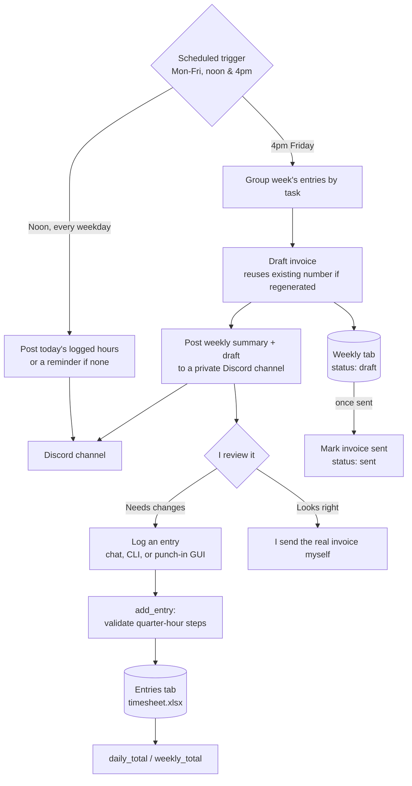

# Contract Timesheet & Invoicing Agent

A hand-built time-tracking and invoicing tool, developed end-to-end in a single Claude Code session as both a working tool for my own consulting practice and a live example of spec-first, AI-assisted delivery I could show a client. Logs billable hours conversationally or through a tiny desktop punch-in screen, totals them daily and weekly, drafts invoices grouped by task, and nudges me on a schedule if I forget to log time — all without ever sending anything to the client automatically.

Built on Claude Code, Python, a local spreadsheet, Discord webhooks, and Windows Task Scheduler.

## The problem

Tracking contract hours by task, totaling them correctly, and turning them into a clean weekly invoice is the kind of work that's simple in principle and easy to let slide in practice — especially the daily discipline of logging time as you go rather than reconstructing it from memory on Friday. I wanted the logging to be nearly frictionless (say it in chat, or punch it into a tiny window), the math to be automatic and provably correct, and a standing nudge that catches me if a day goes by with nothing logged — with a hard rule that nothing involving money ever leaves my machine without me looking at it first.

## Architecture



## How it works

**Data model.** A single Excel workbook, gitignored and never committed, with two tabs: `Entries` (one row per logged entry — date, task, notes, hours, project, created-at) and `Weekly` (one row per week — totals, rate, invoice number, sent date, status). Hours are stored as decimals in quarter-hour steps; anything else is rejected at the point of entry, not silently rounded.

**Logging.** Three ways in, all hitting the same core function: telling Claude Code directly in conversation ("log 3 hours on X"), a plain CLI (`add`/`edit`/`delete`/`list`), or a tiny Tkinter punch-in window for quick entries without opening a terminal at all. Editing and deleting are matched by date + task; if more than one entry matches, the tool refuses to guess and asks for a more specific match instead of silently acting on the wrong row.

**Weekly summary and invoice draft.** Entries for the Monday–Sunday week get grouped by task, with any weekday that has nothing logged flagged explicitly. The draft invoice is generated from that same grouping — task, hours, rate, line total — with a plain placeholder layout (final layout was deliberately deferred past the proof-of-concept stage) and bracketed placeholders for payment terms and details, which weren't decided yet. Regenerating a draft for a week that already has one reuses the existing invoice number instead of burning a new sequence number, so asking for changes doesn't create gaps in the numbering.

**Nudges.** A scheduled task posts to a private Discord channel twice on weekdays — once around midday, once in the afternoon — always posting something, whether that's today's logged hours and running total or an explicit "nothing logged yet" prompt. The afternoon run on Fridays also builds and posts that week's draft invoice summary alongside the nudge, so the weekly close-out happens on a schedule instead of depending on me remembering to trigger it.

**Guardrails.** The agent drafts; it never sends. The invoice file is written locally and the Discord post shows the draft summary, but the actual client-facing invoice is a manual step I take myself, every time. Nothing touching a webhook URL, banking details, or signed contract terms ever gets committed to version control — proven with a test commit at the very start of the build, before any real code existed, that those files stay untracked.

## Design decisions and tradeoffs

**Deterministic code for anything client-facing; the agent stays orchestration-only.** The tool itself — spreadsheet writes, totals, the webhook POST — is plain, boring, fully deterministic Python. Given the same input it always does the same thing. The agent (Claude Code) is the layer on top that decides *when* to call which function and interprets what I ask for in conversation. Keeping the money-touching logic deterministic and auditable, with the agent only orchestrating it, was a deliberate split, not an accident.

**Gitignore and a proven test commit before any code.** The very first build step wasn't a feature — it was proving that the webhook config, the spreadsheet, its CSV export, and generated invoices couldn't be committed, by creating placeholder versions of each and confirming `git status` genuinely ignored them before writing a single line of logic.

**A spreadsheet, not a database.** Volume is low (entries per day, not per second) and the client-facing deliverable is itself a spreadsheet, so using the real file as the single source of truth avoids a sync problem entirely. It would not scale past a handful of concurrent contracts, but for one active contract it's the simplest thing that's also the actual evidence document.

**Reuse the invoice number on regeneration.** An invoice number is assigned once per week, the first time a draft is generated, and reused on every subsequent regeneration for that same week. This matters because invoice numbers are sequential and client-visible — regenerating a draft after a requested change shouldn't burn a number and leave a visible gap in the sequence.

**A real bug, left in on purpose.** The Discord webhook returned an opaque `403 Forbidden` on the first live test — not a bad URL, but Discord's edge silently rejecting `urllib`'s default `Python-urllib/…` user agent. The fix was a one-line `User-Agent` header, found by testing against the real webhook rather than trusting that a 200-looking code path would behave the same in production. The scheduled-task setup hit a similar real-world gotcha: `schtasks` mangles nested quoting once the install path contains spaces, which a plain `python.exe script.py --arg` command line does not survive. The fix was routing each scheduled task through a small `.cmd` wrapper instead of inlining the full command, which sidesteps the quoting problem entirely rather than fighting it.

## Tech stack

- **Orchestration:** Claude Code, conversational + CLI
- **Core logic:** Python, `openpyxl` for the spreadsheet, stdlib `urllib` for the webhook (no extra HTTP dependency)
- **Desktop UI:** Tkinter, `pythonw.exe` for a console-free launch, a Desktop shortcut for one-click access
- **Scheduling:** Windows Task Scheduler, two recurring weekday triggers
- **Notification:** Discord webhook, posted as plain text
- **Time handling:** `zoneinfo` with `tzdata`, so weekday/date logic is correct regardless of the host machine's own timezone setting
- **State model:** A single local Excel workbook as both the live database and the client-facing evidence document

## Sample output

Weekly summary, as printed by the CLI:

```
Week 2026-11-09 to 2026-11-15 - 25.5 h total
  data model design: 11.5 h
  stakeholder interviews: 7.0 h
  workflow scoping: 7.0 h
  Missing: 2026-11-12
```

Draft invoice (plain placeholder layout, client and payment details redacted/placeholder):

```
INVOICE DRAFT — NOT SENT
========================================

Invoice Number: 26XX001
Client: [Client]
Billing Contact: [Contact]
Week: 2026-11-09 to 2026-11-15

Line Items
----------------------------------------
  data model design             11.50 h   $  XXX.XX
  stakeholder interviews         7.00 h   $  XXX.XX
      [notes]
  workflow scoping               7.00 h   $  XXX.XX
      [notes]
----------------------------------------
  Total hours:  25.50 h
  Rate:         $XX.XX / h
  Total amount: $X,XXX.XX USD

Payment terms: [TBD]
Payment details: [TBD]

Note: no entries logged for 2026-11-12.

Status: DRAFT. Review before sending — nothing here is transmitted automatically;
I send the final invoice myself.
```

Discord nudge, midday weekday run:

```
Hours logged today (2026-11-09):
- workflow scoping: 3 h
- data model design: 5 h
Running total: 8 h
```

## Results so far

Built and fully tested, end to end, in one working session: repo and gitignore proven safe before any code, the spreadsheet CRUD and totals logic, the weekly summary and draft-invoice generation, the Discord nudges (including catching and fixing the live 403), and the desktop punch-in screen with its own shortcut. The scheduled Task Scheduler jobs are live and running on their real Monday–Friday noon/4pm cadence. The punch-in screen's first real use wasn't mine — I found it already in use, with a test entry logged correctly, before I'd finished writing it up.

## What I'd change next

- **Invoice layout** is still a plain placeholder by design — the spec explicitly deferred that decision past the proof-of-concept stage, and it's the next real decision to make.
- **Per-line invoiced tracking** — right now a draft is generated per week, but there's no record of which individual logged entries have already been billed versus logged since. Work is already underway on this, adding an invoice-number column directly on each entry and the logic to handle partially-invoiced weeks.
- **A real PDF export** instead of the current plain-text draft, so the output is closer to something that can go straight to a client with minimal manual formatting.
- **A punch-in screen that reflects outside changes live** — right now it only refreshes its own display after you log something through it, so an edit made elsewhere (CLI, chat) doesn't show up until you log your next entry.

## The build rules (redacted)

The actual governing instructions, given to Claude Code before any code was written, with client and personal details removed. This is the artifact that kept the build spec-first and incremental rather than a single unscoped "build me a timesheet app" prompt:

```
Build the tool described in SPEC.md. Read it fully before writing code. It is
the source of truth.

START HERE
1. Follow the build order in SPEC.md, starting with step 1: private repo and
   gitignore. Do not move on until a test commit proves the webhook config,
   the spreadsheet, its CSV export and invoice files are not tracked.
2. Build one step at a time and show [me] the result before the next step.
3. This is a proof of concept. Keep it simple and readable, because [I] will
   show the code to the client.

RULES
- Never commit or print the Discord webhook URL. It lives in a local config
  file that is gitignored.
- Keep the signed contract, banking details, and tax forms out of the repo
  and out of this folder.
- Nothing is ever sent to the client automatically. The tool drafts; [I]
  approve and send the real invoice myself.
- Hours are decimals in quarter-hour steps. Rate defaults to a fixed hourly
  figure. Times are in [my] local business timezone.
- Invoice number format and digit count were explicitly left open in the
  spec — ask before generating the first real invoice, don't assume.
- Invoice layout is decided after the proof of concept. Use a plain
  placeholder layout until then.
- Ask before choosing anything the spec leaves open, such as backup location.
```
