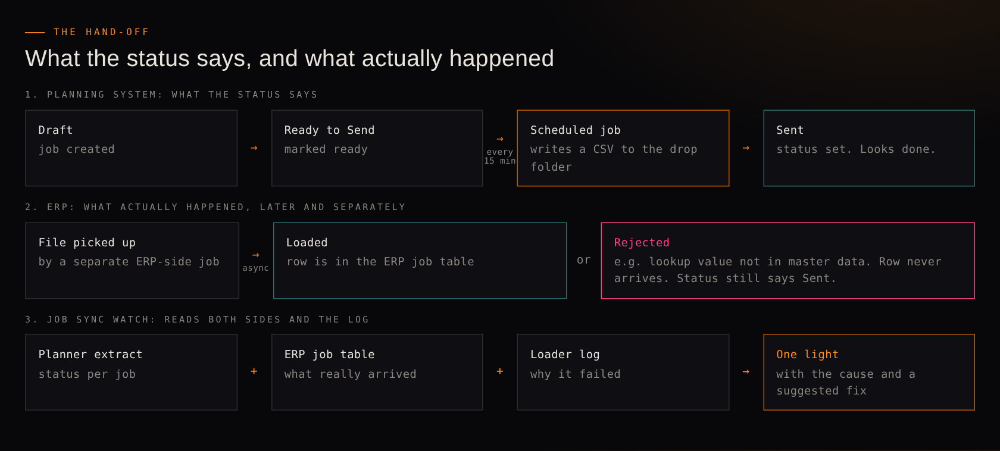
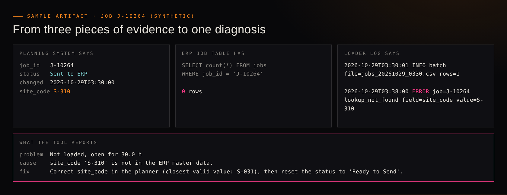
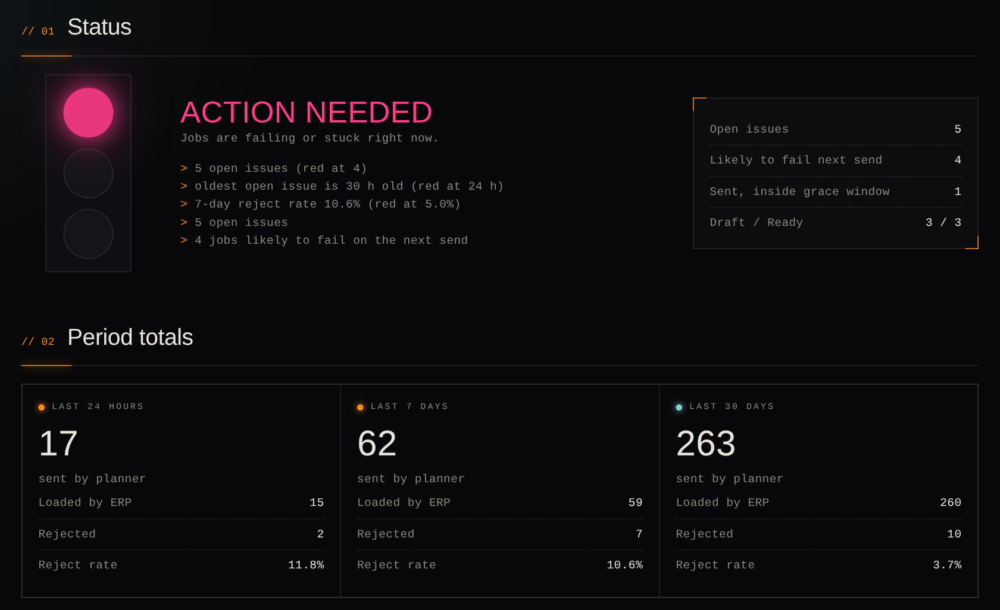
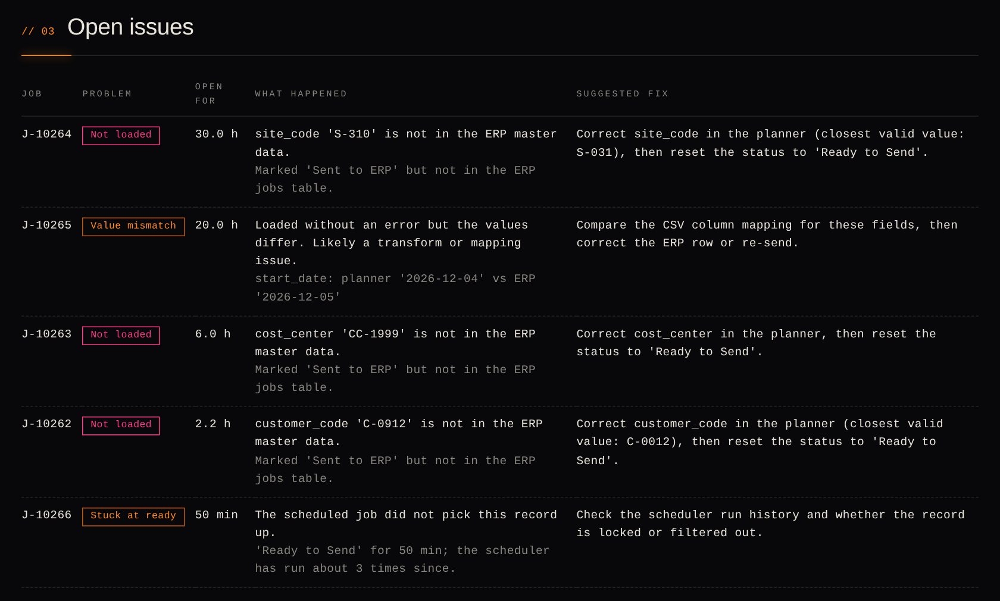
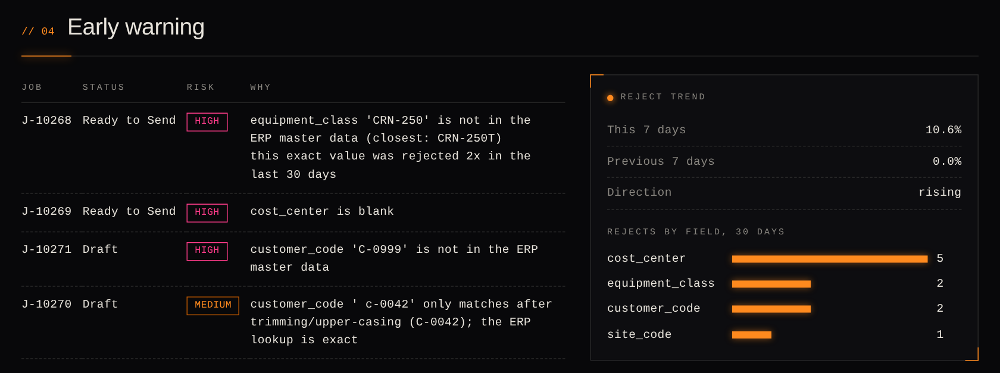
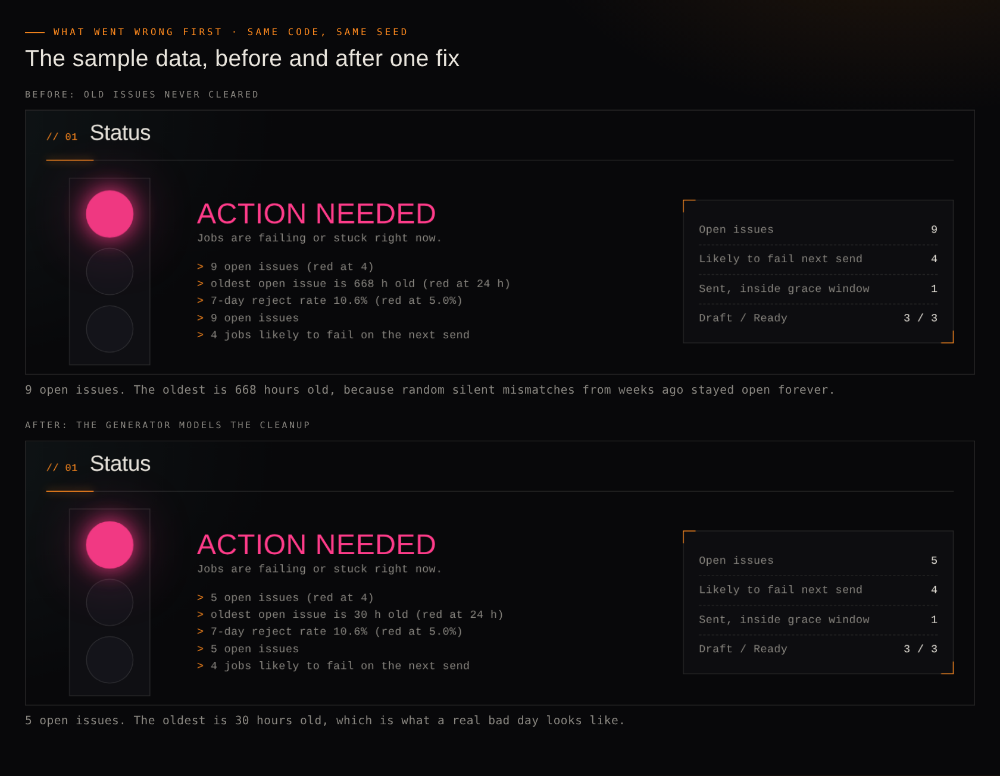
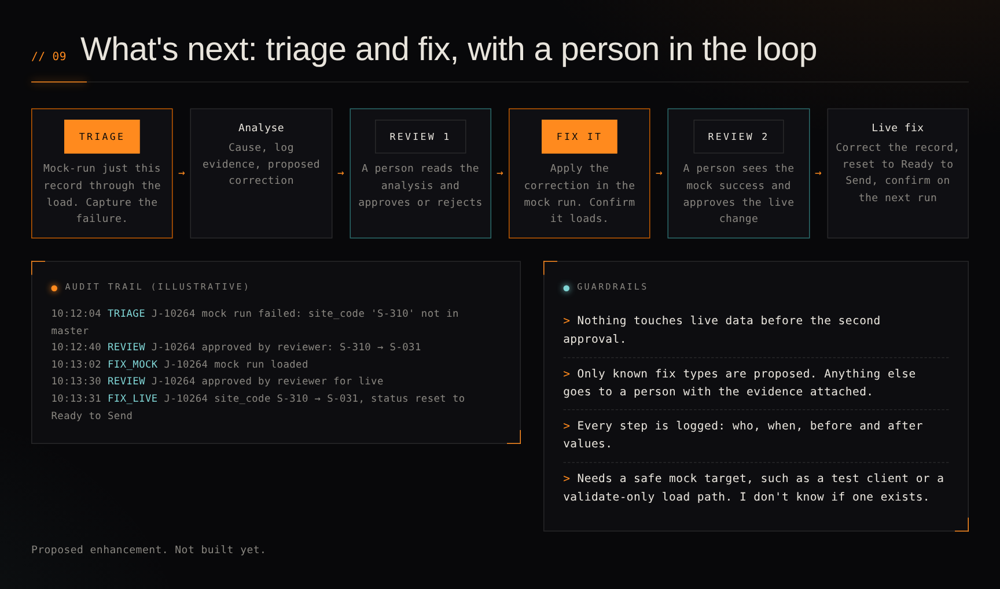

# Job Sync Watch: Making a Silent Integration Failure Visible

**Role:** Product Owner / Business Analyst
**Tools:** Claude, Python (standard library only), SQLite, pytest, a synthetic data generator
**Type:** Integration Monitoring / Root-Cause Analysis

A "sent" status only means a file was written. This is how I turned a daily manual check into a light that is always on, and what my own test data got wrong along the way.

## The problem

This comes from an integration I worked on between a planning product and a customer's ERP, as I last knew it a couple of years ago. Jobs are created in the planning system and move through three statuses: Draft, Ready to Send, and Sent. A scheduled job runs every 15 minutes, collects everything in Ready to Send, writes a CSV to a drop folder, and flips the status to Sent. A separate job on the ERP side picks the file up later.

The trouble is what "Sent" means. It means the file was written. It does not mean the ERP accepted the record, and sometimes it doesn't, usually because of a lookup value the ERP doesn't recognise. Nobody sees that on screen. Someone finds out at the next daily check, which compares the ERP's job tables against an extract from the planning system's API, then searches the logs for the cause, fixes the data by hand, and resets the status so the record is sent again. I wanted that check to be something you could open at any time, with the cause already attached.


*The status flips to Sent when the file is written. The ERP accepts or rejects the record later and separately, and the tool reads both sides plus the log.*

## The approach

I built it as a small Python tool and worked through five decisions in order, each one settled before the code that depends on it:

**1. Define what counts as a failure before computing anything.** A job marked Sent five minutes ago and not yet in the ERP is normal, because the ERP side is asynchronous. So a Sent job gets a 30-minute grace window before it counts. After that there are three kinds of problem: sent but not loaded, loaded but a value differs, and stuck at Ready to Send because the scheduler never picked it up.

**2. Read the log for the cause, but only the part that applies.** Each missing job is matched to the loader log, filtered to errors after the job's latest send, so an old error from before a manual fix doesn't get blamed. When the cause is a bad lookup value, the tool suggests the closest valid one.

**3. Compare the two systems, not just the log.** Some failures never reach the log. In the sample data, a loader shifts a start date by one day and reports success. The log is clean, the status is Sent, and only a side-by-side comparison of the two systems shows it. That check is why the reconcile step matters more than the log reader.

**4. Warn before the job goes out, using rules I can explain.** Jobs still in Draft or Ready to Send are checked for blank required fields, lookup values that aren't an exact match in the ERP's master data, values that only match after trimming or changing case, and values rejected recently. These are written rules, not a model, and every flag lists its reasons. Jobs already marked Ready come first, because they go out at the next run.

**5. Reduce it to one light with thresholds written down.** Red means four or more open issues, any issue older than 24 hours, or a 7-day reject rate of 5% or higher. Amber means any open issue or at-risk job. Green means neither. Under the light sit totals for the last 24 hours, 7 days and 30 days, a reject trend, and the fields that fail most. The thresholds live in a config file so whoever runs the check can argue with them.

I built it with Claude using Python's standard library only. Four reader functions fetch the planning extract, the ERP rows, the lookup lists and the log, so swapping in a real API call, SQL query and log reader means changing one file. A generator makes synthetic data for a bad day and a clean day, and 13 tests cover each rule. The dashboard is one HTML file, and a serve command rebuilds it on every page load.


*A real job from the sample data. The planning system says Sent, the ERP has no row, and the log has the reason. The tool turns the three into a cause and a suggested fix.*

## What came out of it

Everything here runs on invented data. Nothing has been tested against a real system. On the bad-day sample (272 jobs over 30 days) the light is red with five open issues: three rejects open for about 2, 6 and 30 hours, one silent date mismatch, and one job stuck at Ready to Send for 50 minutes. Four more jobs are flagged as likely to fail on the next send, and the 7-day reject rate is 10.6% against 0% the week before. On the clean-day sample the light is green with nothing open. All 13 tests pass, and the published examples rebuild identically from the generator.


*The bad-day sample: one light, the reasons under it, and the totals.*


*Open issues, each with a cause and a suggested fix. The date mismatch (J-10265) has no log entry at all.*


*Early warning: jobs still in Draft or Ready that will probably be rejected, with the reasons.*

**Sample artifacts.** These are the real files behind one failed job in the sample data. The loader log:

```
2026-10-29T03:30:01 INFO batch file=jobs_20261029_0330.csv rows=1
2026-10-29T03:38:00 ERROR job=J-10264 lookup_not_found field=site_code value=S-310
```

And the issue the tool produced from it, exactly as it appears in `projects/job-sync-watch/examples/report-red.json`:

```json
{
  "job_id": "J-10264",
  "kind": "NOT_LOADED",
  "since": "2026-10-29T03:30:00",
  "age_hours": 30.0,
  "detail": "Marked 'Sent to ERP' but not in the ERP jobs table.",
  "cause": "site_code 'S-310' is not in the ERP master data.",
  "suggested_fix": "Correct site_code in the planner (closest valid value: S-031), then reset the status to 'Ready to Send'."
}
```

## What went wrong first

- My first sample data made the dashboard look worse than it should. Random silent mismatches from three weeks earlier stayed open forever, so the oldest issue showed as 668 hours old. A real problem that old would have been found and fixed. The generator now fixes old rejects and only leaves recent mismatches open, because sample data has to model the cleanup as well as the failures.
- A rule that looked broken was a mistake in my test value. A draft with a lowercase, space-padded customer code was reported as "not in the master data" instead of "only matches after trimming". The rule was right: the tidied code didn't exist in the master list either. I swapped in one that did.
- The trend label cried wolf. A single reject in a week moved the label from flat to rising. It now needs at least two rejects before it says rising.
- The suggested fix was sometimes wrong. For one unknown customer code the closest match came back as an unrelated code. I tightened the similarity cutoff so weak matches aren't offered at all.


*Same code and same seed. Only the sample-data generator changed.*

## Why this is the interesting part

The comparison code is short. The hard decisions were about definitions: what counts as a failure, what a status actually promises, and how much to trust a suggested fix. Separating "what the system says happened" from "what happened" is a business analysis habit, and here it's built into a tool. I also kept the machine's role narrow. It finds, explains and warns, and a person still decides and fixes. If I did it again I'd sit with the person who runs the daily check before writing any rule, and write down the failure types they see, instead of starting from my own memory of the integration.

## Next steps

Test it against real, anonymised reject history and a real loader log. The exact-match lookups and the 30-minute grace window are my assumptions until someone who runs the integration checks them. After that comes an alert when the light changes colour, then a triage-and-fix flow: mock-run one failed record, show the analysis to a person, apply the fix in the mock run, and ask for approval before any live change, with every step logged. That flow is proposed, not built.


*A slide from the walkthrough deck: the proposed triage-and-fix flow with two human review gates and an audit trail. Proposed, not built.*

Code, tests and sample data: [`projects/job-sync-watch`](../projects/job-sync-watch/). Live demo: [bad day](https://gordosgit.github.io/Portfolio.GT/demos/job-sync-watch/dashboard-red.html), [all clear](https://gordosgit.github.io/Portfolio.GT/demos/job-sync-watch/dashboard-green.html).
