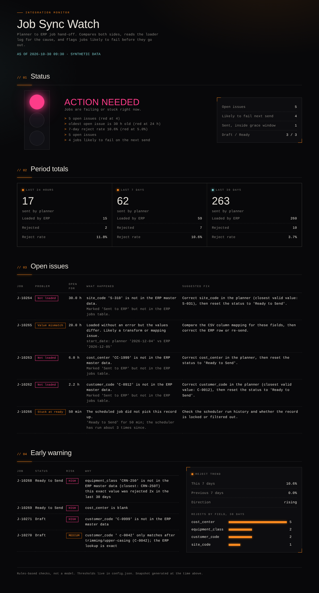

# Job Sync Watch

A traffic-light dashboard that checks whether jobs created in a planning system actually landed in the ERP, explains the failures from the loader log, and flags jobs that are about to fail before they are sent.



## The problem

A common integration pattern: jobs are created in a planning system and move through statuses (`Draft`, `Ready to Send`, `Sent to ERP`). A scheduled job runs every 15 minutes, collects everything in `Ready to Send`, writes a CSV to a drop folder, and flips the status to `Sent to ERP`. A separate ERP-side job picks the file up later.

The status flip only means "the file was written". It does not mean the ERP accepted the row. When the ERP rejects a row, usually because of a bad lookup value, nobody finds out until someone runs a check, compares the two systems, reads the logs, fixes the value and resets the status by hand. That check happens once a day, so a failure can sit unnoticed for hours.

This project replaces the morning check with something you can open at any time.

## What it does

1. **Reconciles** the planner's job extract against the ERP jobs table and finds three kinds of problem: sent but not loaded, loaded with different values, and stuck at `Ready to Send`.
2. **Explains** each failure by matching it to the loader log, and suggests the fix, including the closest valid lookup value when it's a typo.
3. **Warns early** about jobs in `Draft` or `Ready to Send` that would be rejected: blank required fields, lookup values not in the ERP master data, values that only match after trimming or changing case, and values that were rejected recently.
4. **Summarises** the last 24 hours, 7 days and 30 days, with a reject trend and the fields that fail most.
5. **Sets one light**: green, amber or red, with the reasons listed under it. Thresholds are in `config.json`.

## Demo

**Live:** [bad day](https://gordosgit.github.io/Portfolio.GT/demos/job-sync-watch/dashboard-red.html) and [all clear](https://gordosgit.github.io/Portfolio.GT/demos/job-sync-watch/dashboard-green.html). The same files are in `examples/`, built from the synthetic data in `examples/sample-data/`.

The red example has three open rejects (2 h, 6 h and 30 h old), one silent date mismatch, one job stuck at ready, and four jobs that will fail on the next send. It also shows the 7-day reject rate at 10.6%, up from 0%.

## Install and use

Python 3.10+ and the standard library. `pytest` is only needed for the tests.

```bash
# 1. make synthetic data (an ERP stand-in in SQLite, a planner extract, a lookup list, a loader log)
python scripts/generate_data.py --out data/messy --scenario messy

# 2. build a dashboard once
python -m jobwatch build --data data/messy --out dashboard.html --json report.json

# 3. or serve it; every page load rebuilds from the current data
python -m jobwatch serve --data data/messy --port 8080

# optional: append your own CSS file after the built-in styles
python -m jobwatch build --data data/messy --theme my-theme.css

# tests
python -m pytest
```

Add `--now 2026-10-30T09:30:00` to either command to pin the clock, which is how the examples were built.

To use it against real systems, replace the four readers in `jobwatch/loaders.py` (planner API call, ERP SQL query, lookup query, log parser). Nothing else reads the data.

## How it works

```
planner extract ─┐
ERP jobs table  ─┼─> reconcile.py ─┐
loader log      ─┤                 ├─> summary.py ─> render.py ─> dashboard.html
ERP lookups     ─┴─> risk.py ──────┘
```

- `reconcile.py` compares the two sides. A job marked `Sent to ERP` gets a 30-minute grace window because the ERP consumer is asynchronous. After that, a missing row is an issue.
- The cause comes from the log, filtered to errors **after** the job's latest send, so an old error from before a manual fix doesn't get blamed.
- `risk.py` is a set of explicit rules, not a model. Each flagged job lists the reasons. That is a choice: the rules can be checked against the loader's actual behavior, and the output can be explained to the person who has to fix the data.
- `summary.py` sets the light. Red if there are 4 or more open issues, any issue is older than 24 hours, or the 7-day reject rate is 5% or higher. Amber for any open issue or at-risk job. Otherwise green.
- `render.py` writes one self-contained HTML file. Status colours are paired with text labels, so the page doesn't rely on colour alone. The page uses my personal brand's dark cockpit style. Green is cyan, amber is amber and red is neon pink, which stretches that palette's usual meaning for pink.

## Limitations

- **All data is synthetic.** The loader behavior (exact-match lookups, a silent date shift) is my assumption of a typical integration, not a description of any real system.
- **It is a snapshot, not a stream.** `serve` rebuilds on every request, but nothing pushes alerts. There is no email, Slack or paging.
- **The early warning is rules, not prediction.** It can only catch failure types someone has written a rule for. It does not learn new ones.
- **Reject rate comes from the log.** If the loader fails without writing a log line, the job shows up under "not loaded" but not in the reject counts.
- **No fix action.** It suggests a fix and does not reset any status. That was left out on purpose for a first version.
- **Not production-ready.** No auth, no error handling for a missing or locked data source, no tests against real data volumes.

## Future ideas

- Push alerts when the light changes colour
- Triage and fix with a person in the loop: mock-run one failed record, show the analysis for review, apply the fix in the mock run, then ask for approval before the live correction. Every step goes in an audit log. Needs a safe mock target for the ERP load.
- Learn field rules from loader history instead of hand-written rules
- Per-customer and per-site breakdowns of rejects

## What I learned

- The hard part was not the comparison. It was deciding what counts as a failure: a job sent 5 minutes ago and not yet loaded is normal, so the grace window had to exist before the numbers meant anything.
- A silent mismatch (loaded fine, value differs) is the worst kind, because the log is clean. It only shows up by comparing the two sides, which is why the reconcile step matters more than the log reader.
- Early warning on a few explicit rules was more useful, and easier to trust, than a vague "risk score".

## License

MIT. See `LICENSE`.
